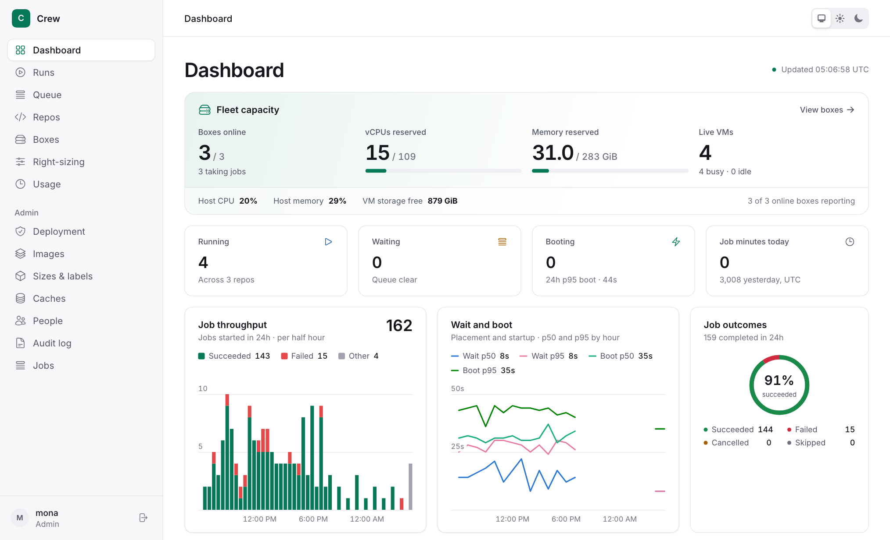
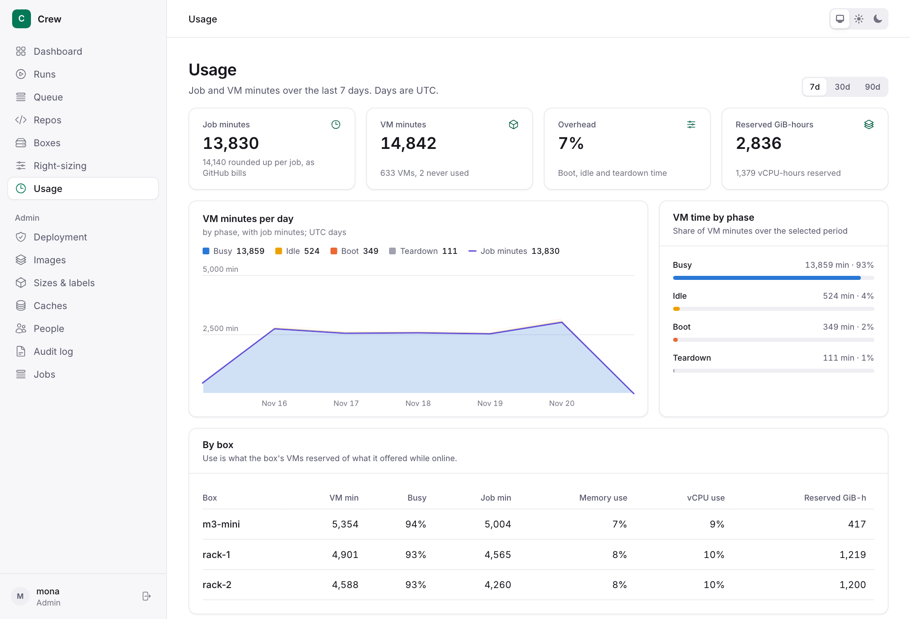
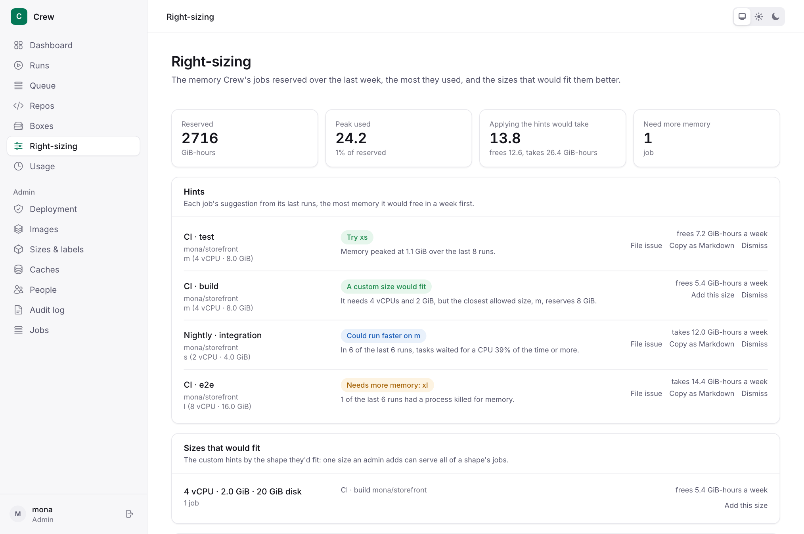

# Crew

Crew runs GitHub Actions jobs on hardware you own. A workflow picks a runner
with `runs-on`. Crew finds a worker with room, boots a fresh Linux VM, and
registers a single-use runner with GitHub. When the job finishes, Crew
destroys the VM and returns its CPU and memory to the pool.

The dashboard shows which workers (called *boxes*) are online, how much
capacity is reserved, and how long jobs spend waiting for a box and booting.
The screenshots in this guide show an example fleet.



## Run your first job

Once your repository and a box are connected, save this as
`.github/workflows/crew.yml` on the default branch. In GitHub Actions,
open **Try Crew** and choose **Run workflow**. The step prints the guest OS
and CPU architecture in the job log.

```yaml
name: Try Crew
on: workflow_dispatch

jobs:
  runner-info:
    runs-on: crew-m
    steps:
      - run: uname -sm
```

Use the same `runs-on` label in an existing job to move it to Crew. The
built-in `m` size provides 4 vCPUs, 8 GiB of memory, and a 60 GiB disk.

| Label | When to use it |
| --- | --- |
| `crew` | Use the deployment’s default size on either architecture. |
| `crew-m` | Request a medium VM on either architecture. |
| `crew-m-arm64` or `crew-m-x64` | Run a build or test that needs a particular architecture. |
| `crew-s-spare` | Let a small, lower-priority job wait for spare capacity. |

Admins can change sizes under **Sizes & labels**. [Runner labels and sizes](docs/crew_spec.md#7-labels-and-sizes)

## Set up a fleet

The control plane runs in Docker and handles GitHub events, scheduling, and
the web UI. Boxes supply the compute. A dedicated Linux machine can run
Flatcar directly, or a Linux host with nested KVM can run a Flatcar VM.
Apple Silicon Macs can run arm64 Linux guests with Virtualization.framework.
An M3 or later on macOS 15+ can also host a nested Flatcar VM.

1. On the control-plane host, create `/etc/crew/crew.env`, owned by root
   and readable only by root. Set `PHX_HOST` to its full tailnet hostname
   and `CREW_ADMINS` to your GitHub login. Generate separate values for
   `SECRET_KEY_BASE` (`openssl rand -hex 64`) and `CREW_ENCRYPTION_KEY`
   (`openssl rand -base64 32`). Save the command outputs as the values.
2. From the checkout root, run `sudo docker compose -f docker/compose.yml up -d`
   with Docker Compose 2.30 or later. The default image stores SQLite data
   in the `crew-data` volume. Follow the Tailscale commands in the Compose
   file to serve the dashboard on your tailnet and expose the GitHub webhook
   listener through Funnel. [Compose configuration](docker/compose.yml)
3. Open `https://<your-tailnet-host>/setup` and enter the one-time token
   from `sudo docker logs crew`. Create the GitHub App and install it on
   the repositories whose jobs Crew should run.
4. Sign in, open **Boxes → Add box**, and choose the host type. Follow its
   enrollment instructions. When the dashboard shows the box taking jobs,
   run the example workflow above.

For more on host requirements, network access, and what a job VM can reach,
see the [deployment guide](docs/crew_spec.md#5-hosts-and-deployment) and
[security model](docs/security.md).

## See where the capacity goes

**Usage** separates time spent running jobs from time spent booting, idle,
or tearing down VMs. Start with the fleet totals, then look by box,
repository, or runner size to see what used the capacity.



**Right-sizing** uses measurements from recent runs to suggest changes to
`runs-on`. In this fleet, the test job peaked at 1.1 GiB across eight runs
on an 8 GiB VM. The report suggests `xs` for that job and a larger size
for an end-to-end job that ran out of memory.



## Upgrades and development

Before updating, check the fingerprint on **Deployment** against the
[release signing key](packaging/release/release-key.pub). Crew’s Ed25519
key is `SHA256:TrcrLZdM0LoA/2ExLBqg2MH7QNVZazyPsHqhb5jDt+8`.
See the [upgrade guide](docs/setup/upgrading.md) for updates and rollback.

The control plane, box agent, guest, registry cache, and shared protocol
are separate Mix projects in [apps/](apps/). The VM helpers live in
[native/](native/) and the guest and Flatcar build files in [images/](images/).
The [design spec](docs/crew_spec.md) and [architecture notes](docs/architecture.md)
cover how the pieces fit together, including what Crew shares with
[Foreman](https://github.com/ntodd/foreman).

With the tool versions in [mise.toml](mise.toml) installed, run the
shared protocol tests from the checkout root.

```sh
cd apps/crew_protocol
mix deps.get
mix test
```
